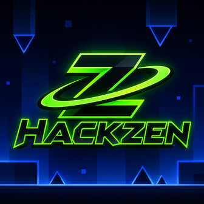

  
  <h1>HackZen</h1>
  
<strong>Geometry Dash, but make it zen.</strong>

  
Fast tools, clean UI, smart practice, and zero menu clutter.

  

    
    
    
  

> **HackZen v2.0.1 Alpha is a private-build, install-only release.** This public repository contains documentation and artwork only. No source code or source archive is published here.

HackZen is a themeable Geometry Dash mod menu built around a draggable round logo. It combines practice helpers, speed and click tools, replay macros, AI autoplay, local vision assistance, HUD overlays, and a highly customizable interface in one compact menu.

## Install

### Recommended: install through Geode

1. Install [Geode](https://geode-sdk.org/install) for your Geometry Dash version.
2. Open Geometry Dash and tap the Geode button on the main menu.
3. Open the **Download** tab and search for HackZen when the mod listing is available.
4. Install HackZen, then restart the game if Geode asks you to.

### Manual: install the release package

1. Install Geode first.
2. Download [`ianangelo.cheatmenu.geode`](https://github.com/Nail120212/HackZen/releases/tag/v2.0.1-alpha).
3. Place the `.geode` file in your Geometry Dash `geode/mods` folder.
4. Launch the game and tap the round HackZen logo.

Geode’s official FAQ documents the manual `.geode` installation path and its built-in mod browser. If HackZen causes a startup problem, use Geode Safe Mode to launch without mods, then remove or disable it.

## What is new in v2.0.1 Alpha

- **AI Vision** adds local sensor rays around the player. Clear paths, blocks, and hazards are shown with different colors.
- **Reflex Assist** can react locally to nearby hazards while the selected model plans further ahead.
- **AI Learning** remembers death spots per level, classifies the mistake, and adjusts future reflex timing.
- **Replay input** now follows Geometry Dash’s own input path for more reliable dual, orb, and buffered-input playback.
- **UI polish** brings higher-resolution icons, themed switches, rounded cards, bordered controls, cleaner tabs, and refreshed palettes.
- **Safer menu behavior** closes HackZen when the level-complete or pause screen takes over.

## The menu at a glance

  
  
  
  
  

HackZen uses five main tabs with focused sub-tabs:

- **Main** — Cheats, Speed, Click
- **Player** — Respawn, Practice, Visuals
- **Bots** — Bot, AI, Vision, Models
- **Misc** — Tools, About
- **Settings** — HUD, Labels, Theme, Options, Icon

## Features, explained one by one

<strong>Main → Cheats</strong>

- **Noclip** — Ignore collisions for route testing.
- **Infinite Jump** — Add extra jump control while experimenting.
- **Safe Mode** — Keep assisted gameplay clearly separated from normal play.
- **Unlock Icons** — Preview locked icon options locally.
- **Auto Kill** — End a run at a chosen percentage.
- **Noclip Accuracy Limit** — Stop an assisted run when accuracy drops below your limit.
- **Show Hitboxes** — Make collision areas visible for timing checks.
- **No Death Effect** — Reduce visual clutter during repeated attempts.
- **Noclip Flash** — Show when a blocked collision occurs.
- **Hide UI** — Clear extra interface elements for a cleaner view.

<strong>Main → Speed</strong>

- **Speedhack** — Slow down for practice or speed up for testing.
- **Only In Levels** — Keep speed changes out of menus.
- **Speed presets** — Jump to common values quickly.
- **FPS Cap** — Cycle through Off, 60, 120, 144, 240, and 360.

<strong>Main → Click</strong>

- **Swift Click** — Hold the screen and repeat jump input at a chosen CPS.
- **Auto Click** — Configure hold and release timing for repeat input.

<strong>Player → Respawn</strong>

- **Instant Restart** — Remove the normal death delay.
- **Respawn Delay** — Add a controlled delay when instant restart feels too fast.
- **Confirm Restart** — Prevent accidental restarts.
- **Confirm Exit** — Ask before leaving a level.

<strong>Player → Practice</strong>

- **Auto Practice** — Start levels in Practice Mode automatically.
- **Checkpoint tools** — Create checkpoints while Practice Mode is active.
- **Restart and Practice shortcuts** — Keep common practice actions close.
- **Reset Stats** — Start a clean test without leaving the level.

<strong>Player → Visuals</strong>

- **Show Hitboxes** — Inspect collision data.
- **Hide UI** — Reduce screen noise.
- **No Death Effect** — Keep repeated attempts readable.
- **Noclip Flash** — See exactly when a collision was blocked.

<strong>Bots → Bot</strong>

- **Record** — Capture inputs for the current level.
- **Replay** — Play a saved macro back.
- **Stop** — End recording or replay immediately.
- **Clear** — Remove the current macro.
- **Save** — Store one replay per level name.
- **Folder** — Open or view the macro location.
- **Auto Save** — Save recordings when the level ends.

Macros are stored locally. Older macro formats remain supported where compatible.

<strong>Bots → AI</strong>

- **Groq** — Use a Groq API key for model-driven gameplay planning.
- **OpenRouter** — Use OpenRouter as an alternative provider.
- **Provider switcher** — Change providers without leaving the menu.
- **Reflex Assist** — React locally to nearby hazards while the model plans ahead.
- **Non-blocking planning** — Keep the level running while a plan is generated.
- **Paste and Test** — Paste a key and test the provider connection.
- **Local learning** — Save per-level lessons and tune reflex timing.

AI autoplay is opt-in and uses your own provider quota. Groq keys normally begin with `gsk_`; OpenRouter keys normally begin with `sk-or-`.

<strong>Bots → Vision</strong>

- **Sensor rays** — Scan the space ahead of the player.
- **Clear / block / hazard colors** — Read the local scene at a glance.
- **Planned-jump markers** — See upcoming AI actions.
- **Reflex status ring** — Show thinking, reflex, and holding states.
- **Vision range** — Adjust how far the sensors look.

<strong>Bots → Models</strong>

- **Auto (fastest)** — Prefer a fast available model automatically.
- **Live model lists** — Load current models from the selected provider.
- **Paged browsing** — Navigate long model lists cleanly.
- **Free-only filter** — Filter OpenRouter models marked `:free`.
- **Custom model ID** — Enter a known model ID directly.
- **Fallback behavior** — Return to Auto when a selected model disappears.

<strong>Misc → Tools and About</strong>

- **Pause In Menu** — Pause gameplay, music, effects, and the HUD timer while the menu is open.
- **Reset Music Vol** — Restore music volume to 100%.
- **Reset SFX Vol** — Restore effects volume to 100%.
- **Reset All** — Reset HackZen settings while keeping API keys and model choices.
- **Version info** — View the installed build and mod identity.
- **Stable mod ID** — Updates remain connected to `ianangelo.cheatmenu`.

<strong>Settings → HUD and Labels</strong>

- **HUD values** — FPS, clock, level timer, deaths, hits, accuracy, frames, best percentage, CPS, progress, level name, and attempts.
- **Cheat label** — Show assisted-gameplay status.
- **Speed label** — Show the current speed value.
- **AI and bot status** — See recording, replaying, thinking, reflex, and error states.

<strong>Settings → Theme and Options</strong>

- **Themes** — Classic, Crimson, Blurple, Noir, and Custom Gradient.
- **Gradient direction** — Horizontal, vertical, or diagonal.
- **Glassy mode** — Soften panels with a glass-like finish.
- **Light animations** — Toggle small interface motion.
- **Sidebar icons** — Show or hide tab icons.
- **Outline glow** — Add extra edge contrast.
- **Menu opacity and scale** — Tune the interface to your screen.

<strong>Settings → Icon</strong>

- **Round draggable logo** — Drag to move it and tap to open HackZen.
- **Show / hide icon** — Keep the logo visible only when you want it.
- **Auto Hide Icon** — Fade it away when unused.
- **Lock Icon** — Prevent accidental movement.
- **Hide Menu Button** — Use the floating logo as the only entry point.

## AI privacy

AI Autoplay is opt-in. When enabled, HackZen sends approximate gameplay state and nearby object information to the provider you choose. Your API key is stored in the mod’s local save data and used for authentication with that provider. Use a revocable key, monitor your quota, and never share it in screenshots, issues, or public posts.

HackZen does not include telemetry or a remote account system. It is not affiliated with RobTop Games, Geometry Dash, Geode, Groq, or OpenRouter.

## Compatibility

- Geometry Dash target: **2.2081**
- Geode SDK build: **5.11.2**
- Release: **v2.0.1 Alpha**
- Geode mod ID: **`ianangelo.cheatmenu`**

Geode notes that major Geometry Dash updates can temporarily require a Geode update. Check the [official Geode install page](https://geode-sdk.org/install) before updating the game.

## Public repository policy

This repository is the public landing page for HackZen. It contains the README, logo, interface artwork, and release links only. The implementation source and build repository are private. Do not redistribute, repackage, or claim the mod as your own.

  
   
  HackZen — stay cracked, stay zen.

